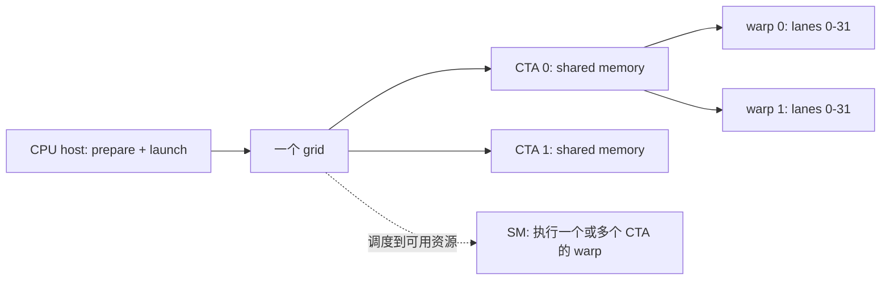

# 从零开始：读懂并运行第一个 GPU kernel

本章假设你会写普通 C/C++ 函数和 Python 数组操作，但还没有写过 CUDA。
先不考虑 attention：把一个矩阵转置正确并做快，已经能学到后续所有关卡需要的地址、并行分工、存储和同步。
本章配合 [s00 的完整源码](../solutions/s00_layout/kernel.cu) 阅读；自己的实现仍写在 `students/cuda/s00_layout/`。

## 1. 一个函数为什么会执行很多次

CPU 上的普通 `transpose(x, y)` 只有一条当前执行流。CUDA 的 `__global__` 函数称为 kernel，由 host 端发起一批 GPU 线程执行。
例如 `transpose<<<grid, block, shared_bytes, stream>>>(...)` 中，尖括号指定执行规模，圆括号传入输入指针和尺寸。
它不是把输入传给“一个很快的 CPU 函数”，而是让许多线程运行同一份函数体，每个线程根据自己的编号处理不同数据。

| 名称 | 在本课程中的含义 | 能否由 launch 直接决定 |
|---|---|---|
| host | 发起 GPU 工作的 CPU 代码；构建、分配、准备参数在这里完成 | 编写普通 C++ / Python |
| kernel | 所有参与线程执行的设备函数 | 选择调用哪个函数 |
| grid | 本次 launch 的全部 thread blocks | `grid` 指定各轴 block 数 |
| block / CTA | 一组可用 shared memory、可做 CTA barrier 的线程 | `block` 指定各轴线程数 |
| warp | CUDA 执行线程的 32 线程分组 | 由 block 的线性线程编号划分 |
| lane | 线程在所属 warp 中的编号，0–31 | 从线性线程编号求余 |
| SM | GPU 上执行 warp、保存其寄存器/shared memory 的硬件单元 | 普通 launch 不指定某个 block 放到哪个 SM |

二维 block 的线性线程编号是 `t = threadIdx.x + blockDim.x * threadIdx.y`；因此 `warp = t / 32`、`lane = t % 32`。
在 `block=(32,8)` 中共有 256 个线程、8 个 warp；每个固定的 `threadIdx.y` 恰好对应一个 warp。
一个 SM 可以同时驻留多个 CTA，具体数量受到寄存器、shared memory 和线程资源限制。
**block 的编号不是 SM 编号，也不能假设不同 block 按编号依次执行。**



## 2. 数组不是二维小方格，而是一段线性存储

连续矩阵 `X[R,C]` 的元素 `(r,c)` 位于 `X[r*C+c]`，其中 `X` 的指针加法以元素为单位。
若元素是 FP32，这个地址相对起点的字节偏移为 `4*(r*C+c)`。
例如 `X=[[0,1,2],[3,4,5]]`，线性存储是 `[0,1,2,3,4,5]`。
转置 `Y=Xᵀ` 的 shape 是 `[3,2]`，线性存储应为 `[0,3,1,4,2,5]`。
因此转置的地址等式是 **`Y[c*R+r] = X[r*C+c]`**；只改变 shape 不会完成这个数据重排。

后续 attention 使用连续 `[B,N,H,D]`。位置 `(b,n,h,d)` 的元素偏移为：

`offset = (((b*N+n)*H+h)*D+d)`。

取 `B=2,N=3,H=2,D=4`，`(b,n,h,d)=(1,2,1,3)` 的偏移是 `47`，恰好是这 48 个元素中的最后一个。
固定 batch 和 head 后，相邻 token 的间距是 `H*D=8`，不是 `D=4`。
把它误当成连续 `[B,H,N,D]`，即使 shape 数字看起来相似，也会读错 token/head；这就是课程专门测试 `B>1,H>1` 的原因。
`contiguous` 描述逻辑维度和 stride 的关系，并不保证切片起始指针满足 TMA/向量指令的对齐要求；需要的对齐另见每课支持域。

## 3. 数据放在哪里，决定谁能复用它

| 存储 | 谁可以直接使用 | 典型生命周期 | 第一个实验中的用途 |
|---|---|---|---|
| global memory | 所有 CTA 都可寻址，是否有序仍需同步协议 | 由 host 分配直到释放 | 输入 X、输出 Y |
| shared memory | 同一 CTA 的线程；普通 CTA 不能借此访问别的 CTA 数据 | 该 CTA 执行期间 | 临时转置 tile |
| registers | 当前线程；跨线程传值需要明确指令/存储 | 线程执行期间的活跃变量 | row/col、临时数据、后续累加器 |

源码中的标量变量通常进入寄存器，但“写了局部数组”不保证整个数组一定留在寄存器里。
寄存器需求太大时，编译器可能把部分状态放到 local memory，后者实际上通过设备内存层次访问。
shared memory 也有容量限制；为每个 CTA 分配更多空间可能减少同一 SM 上能同时驻留的 CTA 数。
学习优化时要问的是“哪些数据被哪些线程重复使用、要存活多久”，而不是一律把数据搬进 shared memory。

## 4. 顺着 s00 源码读一次完整转置

先读文件末尾的 `student_launch`。host 从 `TensorView` 取出 `[R,C]` 和设备地址；输出已经由公共设施分配。
`grid=((C+31)/32,(R+31)/32)` 表示每个 CTA 处理一个最多 `32×32` 的输入 tile，`block=(32,8)` 表示使用 256 个线程。
整数除法加上 `31` 是向上取整；例如 `[33,65]` 需要 `grid=(3,2)`，边缘 CTA 只能覆盖一部分有效元素。

再读 kernel 的第一组 `row`、`col`：

`row = blockIdx.y*32 + threadIdx.y`；`col = blockIdx.x*32 + threadIdx.x`。

每个线程在 `offset=0,8,16,24` 时各读一个元素，所以一个 CTA 的 256 个线程共同读入 1024 个元素。
固定 warp 的 `threadIdx.y`，它的 32 个 lane 沿相邻 `col` 读取连续 FP32。
这种访问给硬件合并访存创造条件；具体事务数还取决于对齐、边界和缓存，不能只凭图就声称测到了某个 DRAM 带宽。

加载后执行 `__syncthreads()`。一个线程随后读取的 shared 元素可能来自同 CTA 的另一个线程，因此必须等待所有生产者完成。
CTA barrier 要由参与 CTA 的线程一致到达，不能让边缘线程在 barrier 前仅因为“没有输入可读”就提前返回。
代码用 `if` 保护具体加载/存储，所有线程仍执行 barrier。

接着，第二组 `row`、`col` 交换了 tile 的横纵坐标，并从 `tile[threadIdx.x][threadIdx.y+offset]` 读取。
于是相邻 lane 在输出 Y 的一行写入连续位置；输入端和输出端的连续访问都得到保留。
可把整个过程看作：**连续读 X → CTA 内重排 → 连续写 Y**。

为什么 shared 数组声明成 `tile[32][33]`，而不是 `tile[32][32]`？
以常见的 32 个 bank、每个 FP32 对应一个 bank 单位来推理：元素 `(r,c)` 的 bank 编号可按 `(r*stride+c)%32` 理解。
转置读取时，相邻 lane 改变 `r` 而固定 `c`；stride=32 会让它们落在同一 bank，stride=33 则分散到不同 bank。
这多出来的一列只用于改变物理步长，不属于输入/输出的逻辑矩阵。
后续 Tensor Core/TMA 的 swizzle 也是在解决具体访问模式下的布局问题，但不能直接照搬这个 padding 公式。

最后核对边界：有效输出 `Y[c,r]` 所读取的 shared 位置，正好对应有效输入 `X[r,c]`。
只有在这个条件成立时，读取 shared 中未初始化的边角位置才会被避免；“我给 store 加了 if”本身还不是完整证明。
用 `[33,65]` 手画右下角 CTA，可以检查这个对应关系。

## 5. CPU 返回了，不代表 GPU 已经完成

CUDA launch 通常把工作排入 stream 后就返回 host。一个 stream 内的工作按该 stream 的依赖顺序执行；不同 stream 之间需要明确依赖。
因此 `t0=CPU时间; launch(); t1=CPU时间` 通常主要测到提交开销，不能作为 kernel 完成时间。
在末尾做同步能观察完成，但会把 Python 调度、提交间隙、同步等待等成本也计入 CPU wall time。

CUDA event 记录在 stream 的执行序列中。把起止 event 放在被测操作前后，结束后等待结束 event，再读取 elapsed time，才是在测设备时间线上的区间。
这个区间也可能含 host 提交不及时造成的 stream 空隙，因此课程还提供 CUDA Graph：先 capture，再 replay 固定的一组工作，降低逐次 Python 发起造成的间隙。
Graph 的构建、编译和输入分配不计入 replay；设备上的布局转换、输出拷贝仍是工作，必须计入。

本项目的 `prepare` 负责构建、分配和必要的 host 描述符准备，返回可重复调用的 `launch`。
不要在每次 launch 中生成随机输入、重新编译或分配输出，也不要在 prepare 中预先把当前输入的答案算好。
检查还会在非默认 stream 上调用 kernel；设备代码必须使用传入的 stream，写死 stream 0 可能碰巧在小例上正确，却破坏实际依赖关系。

## 6. 做一次能解释结果的实验

先检查环境并运行完整参考；这些命令不会填写学生代码，也不代表学生已通关：

```bash
./lab doctor
./lab task s00_layout -v
./lab solution s00_layout --case 0
./lab reference s00_layout --case 0
```

然后在纸上完成 `2×3` 的转置地址表，标出每个输入元素的输出偏移。
再对 `33×65` 的右下角 CTA，写出哪些线程在哪些 offset 上加载/存储，以及所有线程在哪里会合。
这两个练习分别检查索引和协作；如果不能解释，先回到源码，不需要开始调 tile 大小。

开始实现自己的 `students/cuda/s00_layout/kernel.cu`，完成后设置 `IMPLEMENTED=True`，先运行 `check --case 0`，再运行不带 `--case` 的完整检查。
第一次正确后，只改变一个设计：例如保留读写映射而把 shared stride 从 33 改为 32，先复查正确性，再比较同一个 perf case。
预测 bank conflict 是否会改变，并用 profiler 查看；若时间没有明显变化，检查规模、计时波动和真正占主导的工作，不能把预测当成测量结论。

小例用于定位错误，大例用于研究吞吐。读懂一个优化需要同时说清楚：输出为什么正确、线程如何交换数据、具体少做了什么工作，以及证据来自哪次测量。
完成后进入 [s01 softmax](tasks/s01_softmax.md)，把 CTA/warp 的协作从“交换数据位置”扩展到“合并多个线程的数值结果”。
